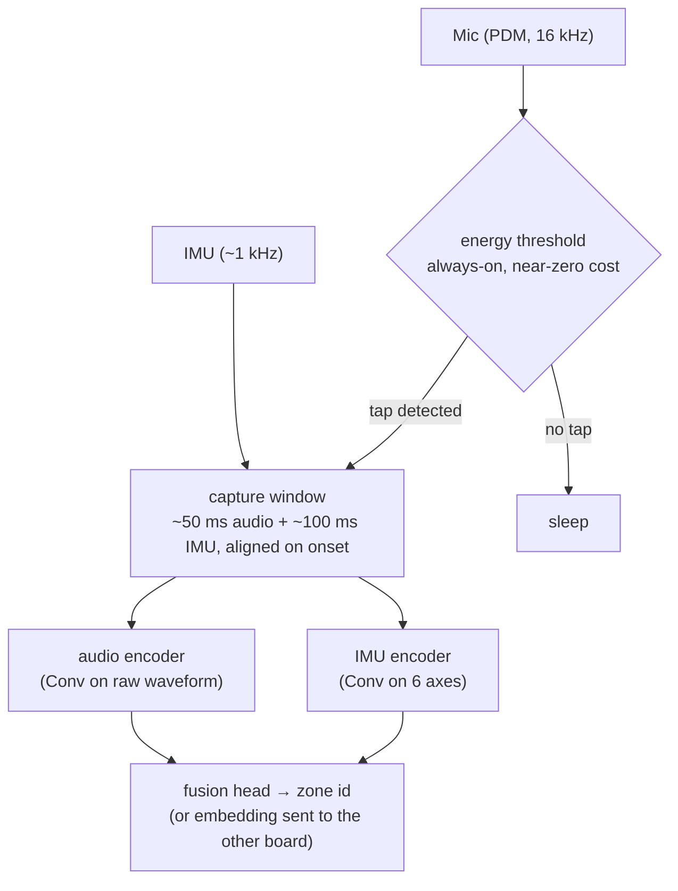
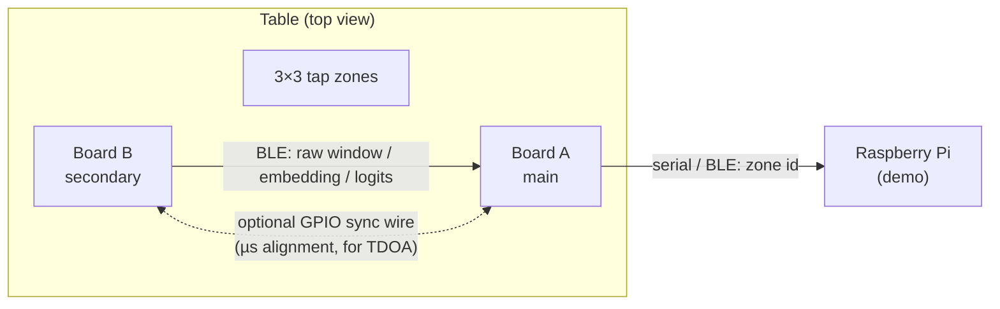
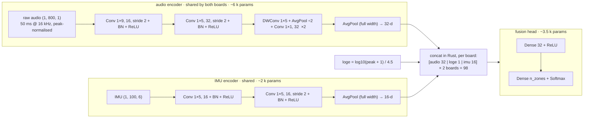

# touchwood

> Turn any table into a touch surface: two Arduino Nano 33 BLE Sense boards stuck under a table recognise **where** you tapped, using compressed neural networks running on the microcontrollers and talking over BLE.

**Status:** internal working notes, early stage. Nothing here is final.

Course project for *IA embarquée* (Embedded AI), 2026–2027. Team of 2, about one month.

---

## 1. Idea

No triangulation is required. Every location on a surface leaves its own vibro-acoustic **fingerprint**, and a small CNN learns to recognise it. A **second board** at the other end of the table adds spatial cues, such as the energy ratio between the boards (see [§3.1](#31-two-board-setup)). We frame the problem as **classification over zones**, starting with a 2×2 grid and moving to 3×3. Regression of (x, y) is a stretch goal.

The core of the project is to **fit the model onto the microcontroller**, applying as many techniques from the course as possible and measuring the effect of each one.

### Why a single sensor can work (hypotheses to validate)

**Microphone** (board glued under the surface, so it picks up structure-borne sound):

- **Attenuation**: high frequencies die out faster with distance, so the spectral tilt depends on distance.
- **Dispersion**: flexural waves in a plate are dispersive (high frequencies travel faster), so the waveform smears out with distance.
- **Edge reflections**: the delays of the echoes off the table edges depend on where the tap happened.
- **Modal excitation**: a tap on a node of a mode does not excite that mode, so each position excites a different mix of resonances.
- **Structure vs. air arrival**: the same tap arrives through wood (~3000 m/s) and through air (343 m/s). At 50 cm the two are ~1.3 ms apart (~21 samples at 16 kHz), which could act as a distance cue. *Unverified.*

**IMU**:

- When the flexural wave passes under the board, the surface tilts locally. The gyroscope measures this, and the ratio of rotation on the X and Y axes may encode the **direction** of arrival.
- ⚠️ This is the weakest hypothesis. The IMU sample rate is at most ~1 kHz and a heavy table barely moves. A lighter, thinner surface (desk panel, shelf, door) should help a lot.

Working assumption: **the microphone carries most of the information and the IMU is a bonus.** A per-modality ablation will tell.

---

## 2. Hardware

| Device | Role |
|---|---|
| 2× Arduino Nano 33 BLE **Sense** (nRF52840, Cortex-M4F @ 64 MHz, **1 MB flash / 256 KB RAM**) ✅ confirmed | Target: always-on sensing and inference. One board is the *main* node, the other is a *secondary* node. |
| Other Arduino Nano boards (exact model **TBD**) | If it is a Nano ESP32, it could be used for Wi-Fi CSI (see [§11](#11-parked-ideas)) |
| Raspberry Pi | Host for the demo (receives zone events), cross-platform benchmark |
| Jetson Nano | Teacher training / inference, TensorRT benchmark |
| *(optional)* piezo disc(s) on an analog pin | Plan B contact microphone; two of them would allow real time-difference-of-arrival (TDOA) |

**TODO:** check the board revision. The `acquisition` firmware detects it from the IMU and prints it when the port opens.
- **Rev1**: LSM9DS1 IMU. The Arduino library defaults to ~119 Hz; it can go to 952 Hz by setting registers.
- **Rev2**: BMI270 + BMM150. The accelerometer goes up to ~1.6 kHz and the gyroscope higher.

---

## 3. Pipeline

Single-node pipeline, which runs on each board:



The board sleeps between taps, which gives us an energy-per-inference argument.

### 3.1 Two-board setup



Put the boards at **opposite ends of the long axis** (or diagonally): the further apart they are, the stronger the cues.

**What the second board adds, from easiest to hardest:**

1. **Inter-board energy ratio** ⭐. The closer board gets the stronger signal. The broadband and per-band energy ratios tell which side the tap was on and roughly how far.
   - Only **coarse sync** is needed: we just have to match the same tap on both boards, within a few ms. BLE is enough.
   - The cue **transfers across tables** much better than raw fingerprints, which helps the generalisation goal.
2. **Two fingerprints instead of one.** Each board sees the tap from a different viewpoint, so they disambiguate each other.
3. **Time difference of arrival (TDOA).** Flexural waves in wood travel at roughly a few hundred m/s and are dispersive. A 10 cm path difference is ~200 µs, or ~3 samples at 16 kHz.
   - TDOA needs clocks aligned to **tens of µs**. ArduinoBLE jitter is around the **ms**, so it is unusable for this.
   - With only 2 sensors, TDOA gives a hyperbola, not a point. It is still useful combined with the fingerprints.
   - Options to get the sync:
     - ✅ **A wire between the boards** (GPIO sync pulse). Trivial and near-perfect.
     - 🧪 **nRF52840 radio timestamping**: wire the RADIO address event to a TIMER capture through PPI, which allows sub-µs sync over the air. This means leaving the Arduino BLE stack (Zephyr / Embassy / bare radio). It is a good fit for the Rust track.
     - 💡 **A sync-free cue**: if the structure-vs-air arrival gap is confirmed (§1), each board measures its *own* distance to the tap. Two distances intersect as two circles, which gives a position without any inter-board sync.

**Fusion strategies (distributed inference / split computing):** what does B send to A?

| B sends | Payload | Trade-off |
|---|---|---|
| Raw window (50 ms @ 16 kHz, int16) | ~1.6 KB | Early fusion. Best accuracy potential, highest radio energy and latency. |
| int8 embedding from B's feature extractor | ~32 B | **Split computing**: each node runs the extractor and A runs the fusion head. |
| Per-zone probabilities (int8) | ~9 B | Late fusion. Cheapest, least expressive. |

To measure for each strategy: accuracy, bytes on air, radio energy, end-to-end latency (tap → decision on A), and flash / RAM on each node.

A third board would make 2D TDOA possible. That is a stretch goal, not the baseline.

### 3.2 Model architecture

Shaped by MicroFlow's operator set (see [§7](#7-firmware-rust)). Since there is no Concat op, there is **one model per branch, and the fusion happens in Rust**, which also matches the BLE split-computing design.



- **Student:** ~12 k parameters (audio encoder 6 k, IMU encoder 2 k, head 3.5 k). Trained on synthetic data, then exported and compiled with MicroFlow: ~11 KB of int8 weights plus ~17 KB of code, for the whole pipeline.
- **Downsampling in the depthwise blocks** is an `AveragePooling2D((1, 2))` after a stride-1 depthwise conv, because TensorFlow cannot train a `DepthwiseConv2D` with unequal strides like `(1, 2)` on CPU.
- **Per-board normalisation:** each board normalises its window by its own peak, so it can run its encoder alone. The peak is kept as a `loge` feature, so the head still sees the energy ratio between boards.
- **Training strategy** (`host/notebooks/02_training.ipynb`): **joint end-to-end training**, plus auxiliary per-branch classifiers and *branch dropout* (randomly zeroing a whole modality or board) against modality competition. This also makes the head robust to a missing board. The encoders are **frozen only for few-shot calibration** on a new session, for fair comparisons of fusion strategies, and for part-by-part compression. On synthetic data, calibrating with 5 taps per zone: frozen encoders 99.9 % vs. everything unfrozen 96.5 %, because the unfrozen model overfits.
- **Teacher** (trained on PC / Jetson): the same structure, 4–8× wider and deeper, with residual connections. It can take a spectrogram as input and early-fuse the raw data of both boards. It is then distilled into the student.
- **Calibration variant:** the same extractors, with an L2-normalised embedding and nearest-prototype classification instead of the last Dense layer.
- **Ablations:** raw waveform vs. log-mel input, one vs. two boards, with vs. without IMU.
- Since the student is already small, we also optimise for **latency and energy**, not only size. A higher PDM sample rate and longer windows would also make the model bigger (the nRF52840 PDM goes above 16 kHz; to be checked).

### 3.3 Datasets

**No public dataset matches**, and none can: the fingerprint depends on the table, the board and where it sits. We collect our own data, which is quick (9 zones × 50 taps × a few conditions ≈ 1–2 h). Related public material:

- Low-energy impacts on a thin plastic plate, 4 corner PZT sensors (Univ. of Patras): [paper](https://deepai.org/publication/dataset-impact-events-for-structural-health-monitoring-of-a-plastic-thin-plate), [Zenodo](https://zenodo.org/record/7199346). Useful to prototype the pipeline or pre-train the teacher before our own data exists.
- Surface-vibration gestures on a desk, 9,000 events including taps and knocks: [arXiv 2605.10110](https://arxiv.org/pdf/2605.10110). Check whether the data is released.
- Background noise for augmentation and a "not a tap" class: ESC-50, FSD50K, MUSAN, DEMAND.
- Method references without public data: [Knock&Tap](https://dl.acm.org/doi/fullHtml/10.1145/3461615.3485428), and [SurfaceVibe](https://dl.acm.org/doi/10.1145/3055031.3055077), which models dispersion and reflections on surfaces.

### 3.4 Generalising to a new table (stretch goal)

- **Baseline:** one model per surface, retrained for each surface.
- **Stretch:** train an **embedding extractor** (prototypical network / metric learning) on data from 5–10 different surfaces. On a new table, the user taps each zone 5–10 times and the board stores the mean embedding per zone. Inference is then a nearest-prototype lookup.
- This means **no backprop on the MCU**, and calibration takes about 30 s.

---

## 4. Course techniques we apply

The deliverable is a **cumulative ablation table**: the same model, step by step, measured **on the device**.

| Step | Accuracy | Params | Flash | RAM (arena) | On-device latency | Energy / inference |
|---|---|---|---|---|---|---|
| Teacher (float32, PC/Jetson) | | | ❌ doesn't fit | | | |
| Student, trained from scratch | | | | | | |
| Student + knowledge distillation | | | | | | |
| + structured pruning / low-rank (SVD) | | | | | | |
| + weight clustering | | | | | | |
| + QAT int8 | | | ✅ | | | |

Checklist:

- [ ] Efficient architecture (1D CNN, depthwise-separable convolutions)
- [ ] Knowledge distillation (big teacher → small student; temperature, α sweep)
- [ ] Pruning: unstructured (magnitude) **vs.** structured (channels). Show that only structured pruning reduces latency and RAM under TFLite Micro.
- [ ] Low-rank factorisation (SVD) of dense / convolution layers
- [ ] Weight sharing / clustering, plus compression (zip / Huffman)
- [ ] Activation sparsity (ReLU threshold, L1 penalty on activations)
- [ ] Quantization: PTQ (dynamic range, float16, full int8) **vs.** QAT
- [ ] Deployment: MicroFlow (Rust) as the main path; TFLite Micro (C++) as a comparison point (latency, flash, RAM)
- [ ] Metrics: accuracy / confusion matrix, size, peak RAM, latency, energy
- [ ] Pareto plot: accuracy vs. size, and accuracy vs. latency
- [ ] Classical baseline: Location Template Matching (cross-correlation + k-NN) vs. CNN, comparing both accuracy and cost
- [ ] Cross-platform benchmark of the same model: Arduino vs. Raspberry Pi vs. Jetson
- [ ] Distributed inference over BLE: early vs. split (embedding) vs. late fusion (§3.1)
- [ ] Ablations by sensor (board A only / board B only / A+B) and by modality (mic / IMU)

---

## 5. Roadmap

### Week 1: feasibility (go / no-go)

- [ ] Identify the board revision (Rev1 / Rev2) of both Sense boards (the `acquisition` firmware reports it); get mic and IMU streaming over serial at the highest usable rates.
- [ ] Data logger: firmware that streams raw samples, plus a Python script that saves labelled taps from **both boards at once** (both on USB).
  - ✅ Written, *not yet tested on hardware*: `firmware/acquisition` (continuous mic) + `host/scripts/record.py`. IMU streaming is still TODO.
  - PC-side alignment is fine for energy ratios and fingerprints, but **not** for TDOA, because of USB jitter.
  - If we want to test TDOA, add the GPIO sync wire from day one.
- [ ] Record **4 corners × 30 taps** on one surface, with the boards at opposite ends, following [`host/DATASET.md`](host/DATASET.md) (Phase 0).
- [ ] Plot spectrograms and gyroscope traces per zone. Can we see a difference by eye? (`host/notebooks/01_feasibility.ipynb`)
- [ ] Quick k-NN / random forest on:
  - **board A only**, **board B only** and **A+B** (energy ratio plus both feature sets);
  - **mic only**, **IMU only** and **both**.
- **Go** if above ~90 % on 4 zones. **Adopt the two-board setup** if A+B clearly beats a single board. **Otherwise**, try a lighter surface or a piezo, or pivot.
- [ ] Minimal BLE link (`trouble-host` + `nrf-sdc`): B notifies A with a small payload on each tap. Measure the latency.
- [ ] MicroFlow model running on the board: ✅ compiles with a placeholder model (`firmware/inference`), not yet flashed.

### Week 2: data and first models

- [ ] Onset detection and windowing (on PC first, then ported to firmware).
- [ ] Dataset v1 ([`host/DATASET.md`](host/DATASET.md), Phase 1): 3×3 grid, finger and knuckle, ≥ 4 sessions varying one factor at a time (operator, day, objects on the table, boards re-glued). **Stream the IMU first.**
- [ ] Teacher model (large, PC/Jetson) and baseline student.
- [ ] Deployment pipeline and on-device measurement harness (latency, arena size, energy).

### Week 3: compression

- [ ] Distillation, then pruning, SVD, clustering and QAT, filling the ablation table.
- [ ] Per-modality ablation (mic / IMU / both) and per-board ablation (A / B / A+B).
- [ ] Fusion strategies over BLE (raw / embedding / logits): accuracy vs. bytes vs. energy vs. latency.
- [ ] *(stretch)* Multi-surface dataset and embedding plus on-device calibration.

### Week 4: integration and report

- [ ] Real-time demo: tap zones control something on the Raspberry Pi (music player, game, slides).
- [ ] Robustness study (moved objects, a different person tapping).
- [ ] Report and presentation.

### Suggested split

- **A:** data, models, distillation and compression (Python).
- **B:** firmware, deployment and on-device measurements (Rust).

Swap and review each other's work regularly.

---

## 6. Risks and mitigations

| Risk | Mitigation |
|---|---|
| IMU signal too weak for direction | Lighter surface, knuckle taps, piezo plan B, accept a mic-only model |
| Fingerprint drift (objects on table, board moved) | Varied data, augmentation, few-shot calibration (stretch) |
| Mic / IMU synchronisation (different rates, I²C latency) | Align both windows on the detected onset; use the IMU FIFO |
| Inter-board sync too poor for TDOA (BLE jitter ~ms) | Rely on energy ratio and fingerprints, which only need coarse sync; GPIO sync wire; radio timestamping as a stretch goal |
| BLE link adds latency or drops packets | Late fusion fallback (A decides alone if B's message is late); measure the end-to-end latency |
| Model already tiny, so little left to compress | Start from a deliberately large teacher; report the full trade-off curve |
| Rust toolchain eats the schedule | Workspace already builds (acquisition + inference). Fallback: Arduino C++ / TFLite Micro for whatever blocks |
| MicroFlow lacks an operator we need | Design the model within its op set (§7); hand-write the missing kernel in Rust; TFLite Micro as fallback |

---

## 7. Firmware (Rust)

Lives in [`firmware/`](firmware/), a Cargo workspace with three crates: `board` (shared board support), `acquisition` (data collection) and `inference` (MicroFlow). Full details in [`firmware/README.md`](firmware/README.md).

- **Stack:** Embassy (`embassy-nrf` 0.11, async), `embassy-usb` (CDC-ACM serial), MicroFlow (`.tflite` → Rust at compile time). For BLE later: `trouble-host` + `nrf-sdc`.
- **Flashing without the Arduino IDE:** `cargo run --release -p <crate>` converts the ELF to `.bin`, does a "1200 baud touch" to reboot into the Arduino bootloader, and flashes with Arduino's fork of `bossac` (the mainline one does not work). The app is linked at `0x10000`, after the bootloader.
- **No debug probe** on the board, so logs go over USB serial. An SWD probe (Pi Pico + *debugprobe*) would enable `probe-rs` + `defmt`.
- **What the Arduino core does silently**, now done in `board`: sensor rail P0.22 (high drive), I²C pull-ups P1.00, mic power P0.17.

**MicroFlow constraints** (found while compiling; not documented upstream):

- Operators: `CONV_2D`, `DEPTHWISE_CONV_2D`, `FULLY_CONNECTED`, `AVERAGE_POOL_2D`, `SOFTMAX`, `RESHAPE`, `TRANSPOSE` only.
- **No Conv1D** (Keras lowers it to `EXPAND_DIMS` / `SQUEEZE`): use Conv2D with a `(1, k)` kernel on a `(1, T, C)` input.
- **No MaxPool, no GlobalAveragePooling** (which becomes `MEAN`): use `AveragePooling2D` over the full width, or strided convolutions.
- **No Concat / Add**: no residual connections and no in-graph branch fusion.
- Static batch size 1, otherwise `Flatten` emits `SHAPE` / `PACK`.
- Dense layers must be quantized **per-tensor** (`_experimental_disable_per_channel_quantization_for_dense_layers = True`).
- Every layer needs a bias, and an all-zero bias gets dropped by the converter. That is fine once trained; keep `use_bias=True`.
- Activations: ReLU / ReLU6 only. BatchNorm is fine (it is folded into the conv).
- Activations live on the **stack**: watch the stack size for bigger models.

`host/scripts/export_microflow.py` applies all of this and checks the op set.

**MicroFlow contribution candidates**, by expected value for this project. Measure first: time each layer on the board with the DWT cycle counter before choosing.

| Contribution | Gain | Why it matters here |
|---|---|---|
| SIMD int8 kernels (Cortex-M4 DSP: `SMLAD`, dual 16-bit MAC), as in CMSIS-NN | **latency / energy**, likely the biggest | MicroFlow's kernels are generic nalgebra loops. The audio encoder costs ~0.77 M MAC per tap (IMU 0.1 M, head 3.7 k, per the TFLite converter): at a few cycles per MAC on a 64 MHz M4, that is tens of ms, *to be measured*. CMSIS-NN reports several-fold speed-ups over reference kernels on the M4 |
| `CONCATENATION` + `ADD` | expressiveness | In-graph fusion instead of Rust glue; residual / inverted-residual blocks (MobileNetV2-style), so the student can look more like the teacher |
| `MAX_POOL_2D` | accuracy / latency | Taps are transients: max pooling keeps peaks, and it is cheaper than strided convolutions for downsampling |
| Per-channel quantization for `FULLY_CONNECTED` | accuracy | It is TensorFlow's default nowadays; per-tensor costs accuracy on small Dense layers |
| `EXPAND_DIMS` / `SQUEEZE`, `MEAN` | ergonomics | Plain Keras `Conv1D` and `GlobalAveragePooling` would just work |
| Static arena / in-place activations instead of the stack | RAM | Needed for bigger models or a higher sample rate |
| Bug: an all-zero bias makes the macro panic (`idx < self.len()`) | robustness | Easy first PR: treat a missing bias as zeros |

---

## 8. Host (Python)

Lives in [`host/`](host/): recording, notebooks, training and export. Details in [`host/README.md`](host/README.md).

Managed with [uv](https://docs.astral.sh/uv/), on **Python 3.13**. Python 3.14+ is not an option yet: TensorFlow, ExecuTorch and the PyTorch→TFLite converter (LiteRT Torch) have no wheels for it, and LiteRT Torch has no Linux aarch64 wheels at all.

```sh
cd host
uv sync --extra cpu         # or --extra cuda (NVIDIA, x86_64) / --extra mps (macOS): pick exactly one
uv run jupyter lab
```

---

## 9. Repo layout

```
firmware/                Rust, runs on the Nano 33 BLE Sense (Cargo workspace)
  board/                 pins, power-up, USB serial, bootloader entry, IMU detection
  acquisition/           streams the microphone over USB for dataset collection
  inference/             MicroFlow model → zone id over USB
    models/tap.tflite    exported by host/scripts/export_microflow.py
  scripts/flash.sh       cargo runner: objcopy + 1200 baud touch + bossac
host/                    Python, runs on the PC (uv project)
  src/touchwood/         shared code: protocol, taps, dataset, model, export
  scripts/               record.py, export_microflow.py, tflite_ops.py
  notebooks/             01_feasibility.ipynb, 02_training.ipynb, then distillation / compression
  data/raw/              recordings (git-ignored)
```

---

## 10. References

- Knock&Tap: classification and localisation of knock and tap gestures (4-mic array): <https://pure.seoultech.ac.kr/en/publications/knockamptap-classification-and-localization-of-knock-and-tap-gest/>
- MIT, Passive acoustic sensing for tracking knocks on large displays: <https://aspirin.media.mit.edu/responsive/wp-content/uploads/sites/4/2013/12/Passive-Acoustic-Sensing-for-Tracking-Knocks-Atop-Large-Interactive-Displays.pdf>
- TapLock, tap detection with an accelerometer on a Nano 33 BLE Sense: <https://www.hackster.io/taplock/taplock-a-bike-lock-with-machine-learning-85641c>
- MicroFlow, a Rust TinyML inference engine: <https://arxiv.org/abs/2409.19432>
- Burn, `no_std` mode: <https://burn.dev/books/burn/advanced/no-std.html>
- Zephyr board notes for the Nano 33 BLE (flashing, bossac): <https://developer.nordicsemi.com/nRF_Connect_SDK/doc-legacy/1.6.1/zephyr/boards/arm/arduino_nano_33_ble/doc/index.html>
- Course material: TinyML, quantization, pruning / clustering (TP3), knowledge distillation (TP4)
- WiFinger, fine-grained finger gesture recognition with Wi-Fi: <https://arxiv.org/abs/2106.00857>
- Espressif TFLite Micro port with ESP-NN kernels: <https://github.com/espressif/esp-tflite-micro>

---

## 11. Parked ideas

Not in the plan, kept here for reference.

- **BLE "radar" with the Nano's radio.** Not viable.
  - Range resolution is c / 2B: ~75 m for one 2 MHz BLE channel, ~1.9 m across the whole 80 MHz band.
  - The nRF52840 only reports RSSI. It supports neither AoA/AoD direction finding nor BLE 6.0 Channel Sounding (those are on the nRF52833 / nRF5340 and nRF54L series).
  - A multi-channel RSSI fingerprint of the *arm* position might separate left from right. That would be a possible negative-result experiment at most.
- **Wi-Fi CSI with ESP32 boards** (Nano ESP32 / ESP32-S3).
  - CSI gives ~52 subcarriers (amplitude + phase) per packet, which is far richer than RSSI. It senses the *hand / arm position*, not the tap itself, so it complements the vibration sensing (vibrations tell *when* the tap happened, CSI tells *where* the hand is).
  - Place TX and RX on opposite sides of the table so the hand crosses the first Fresnel zone (radius ~18 cm at mid-link for 1 m at 2.4 GHz).
  - Downsides: very sensitive to the environment (people moving, posture), and it doubles the acquisition chain.
  - If we try it, run the same week-1 test on CSI only.
  - An alternative without new hardware is Nexmon CSI on a Raspberry Pi 3B+ / 4.
  - Prior art: **RuView / "WiFi DensePose"**, an open-source project that went viral. It claims to estimate body pose, breathing and heart rate, even through walls, from a router plus several ESP32-S3 nodes reading CSI ([coverage](https://www.opensourceforu.com/?p=97115), [PyPI](https://pypi.org/project/wifi-densepose/2.0.0a1/), [a GitHub fork](https://github.com/meterup/ruview)).
    - Its figures are self-reported and unverified (some, like "54K fps", look doubtful), and it is beta software.
    - The underlying science is solid: it builds on CMU's *DensePose from WiFi* (Geng et al.).
    - It confirms that ESP32-S3 + CSI is the right stack, but these systems sense whole-body motion with several nodes. A finger tap on a ~20 cm zone is much finer-grained.
- **Magnetic stylus + magnetometer**: a real localisation technique, but short range (~10–20 cm) and it changes the concept.
- **Capacitive electrodes** (copper tape under the table): proximity sensing at a few cm range; it needs several electrodes to localise.
