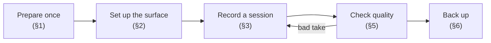

# Dataset recording procedure

How to record the touchwood dataset, step by step. Follow it to the letter: most dataset problems come from small inconsistencies between sessions that nobody wrote down.

**Vocabulary**

- **Session**: one physical setup (a surface, the board positions, a day). Its folder is `data/raw/<session>/`. The test set is a *held-out session*, so a session must be internally consistent and is never mixed with another one.
- **Take**: one continuous recording of one zone (or of noise) by all boards at once. A take is ~25 taps.
- **Zone**: a grid cell, `z0` … `z8`.



---

## 1. Before the first session (once)

**Equipment**

- 2× Arduino Nano 33 BLE Sense (A = main, B = secondary), with 2 USB data cables (not charge-only) long enough to reach under the table.
- Laptop with this repo (`host/` environment synced, `firmware/` builds).
- Masking tape and a marker, a tape measure, thin double-sided tape or Blu-Tack, and gaffer tape for the cables.

**Flash and identify both boards**

```sh
cd firmware
cargo run --release -p acquisition                       # board A plugged alone, on /dev/ttyACM0
PORT=/dev/ttyACM0 cargo run --release -p acquisition     # then board B, plugged alone
```

- Put a sticker **A** and **B** on the boards. Plug A first, so that it gets `/dev/ttyACM0`. Check with `ls /dev/ttyACM*` each time you plug.
- Open each port once (for example with `uv run python scripts/record.py --session _check --label noise_check --seconds 3`). The banner shows the IMU, which gives the **board revision** (`LSM9DS1` = Rev1, `BMI270` = Rev2). Write it in the root README §2, then delete `data/raw/_check`.

> ⚠️ The firmware does not stream the IMU yet. Phase 0 is audio only, which is fine. **Add IMU streaming before Phase 1**, otherwise the main dataset will never have IMU data.

---

## 2. Setting up a surface

**Grid.** Draw a **3×3 grid** with masking tape, with cells of roughly 20 × 20 cm, centred on the table. Number the zones row by row, as seen by the person tapping, sitting at the long side opposite the boards' cables:

|  | left | centre | right |
|---|---|---|---|
| **far** | z0 | z1 | z2 |
| **middle** | z3 | z4 | z5 |
| **near** | z6 | z7 | z8 |

Write the zone names on the tape. For Phase 0, use only the four corner cells (z0, z2, z6, z8), labelled as such.

**Boards.** Fix both boards *under* the table, at **opposite ends of the long axis**, centred, about 5 cm from the edge:

- Fix them **rigidly**: thin double-sided tape or Blu-Tack, pressed hard. Thick foam tape damps the vibrations.
- Use the **same orientation** for both boards. Phase 0 includes a quick test of component side towards the wood vs. away from it; keep the better one for good.
- **Draw the outline** of each board with a marker, so it can be put back in the same place.
- **Tape the USB cables** to the table leg. A cable swinging or rubbing makes noise and shakes the board.

**Measure and write down** (it goes into `--layout`): table size, material and thickness, the position of each board (centre, in cm from the top-left corner seen from the operator), the grid origin and the cell size.

---

## 3. Recording a session

### 3.1 Start

```sh
cd host
ls /dev/ttyACM*                                          # A = ttyACM0, B = ttyACM1 (plug A first)
SESSION=20261110_desk1_s1                                # <date>_<surface>_<setup>
PORTS=A=/dev/ttyACM0,B=/dev/ttyACM1
```

- Use a new `SESSION` name whenever the setup changes: another day, boards re-glued, another surface.
- The **first** command of a session also records its metadata:

```sh
uv run python scripts/record.py --session $SESSION --ports $PORTS --zones 9 --taps 25 \
    --condition finger --operator alix \
    --surface "office desk, chipboard 25 mm" \
    --layout "table 140x70 cm; A at (5,35), B at (135,35); grid 3x3 cells 20 cm, origin (40,5)"
```

The script shuffles the zone order. For each zone, it waits for **Enter**, records until it has heard 25 taps (or 45 s at most), prints a quality line, and asks **[k]eep / [r]edo / [s]kip**.

### 3.2 How to tap

- **About one tap per second, with irregular intervals.** Irregular intervals let the two boards' recordings be aligned automatically.
- **Tap anywhere inside the cell**, at least 3 cm from the tape, and vary the spot. The model must learn the zone, not one point.
- Within a take, use **one tap type only**, the one given by `--condition` (`finger` = fingertip, `knuckle` = knuckle). Use a natural, medium force, and vary it a little.
- **No double taps.** If one happens, finish the take and redo it (`r`).
- **Hands off the table between taps**, including the other hand. Do not lean on the table, and keep the table empty unless the condition says otherwise.
- Keep quiet during a take: no talking, no typing on the laptop if it sits on the same table. Put it on another table if possible.

### 3.3 Takes of a session (~30 min)

| # | Command (after the common options) | Takes |
|---|---|---|
| 1 | `--zones 9 --taps 25 --condition finger` | 9 zones × 25 taps |
| 2 | `--zones 9 --taps 25 --condition knuckle` | 9 zones × 25 taps |
| 3 | `--label noise_silence --seconds 30` | nobody touches anything |
| 4 | `--label noise_speech --seconds 60` | people talking around the table |
| 5 | `--label noise_objects --seconds 60` | putting down and picking up a cup, a phone, a pen; sliding a sheet of paper |
| 6 | `--label noise_typing --seconds 60` | typing on a keyboard set *on* the table |

The `noise_*` takes are not zones. They measure **false triggers** of the tap detector, and later they train a "not a tap" class.

---

## 4. Dataset plan for the month

| Phase | When | Sessions | Content | Purpose |
|---|---|---|---|---|
| **0. Feasibility** | week 1 | 1 (`..._p0`) | 2×2 corners × 30 taps, finger only; plus the board-orientation test (one session per orientation) | go / no-go with `01_feasibility.ipynb` |
| **1. Main** | weeks 2–3 | **≥ 4** on the same surface | the full §3.3 protocol | training and **held-out-session** testing |
| 2. Generalisation *(stretch)* | week 3 | 2 per extra surface, ≥ 2 surfaces | the full protocol | the multi-surface embedding and few-shot calibration |

The Phase 1 sessions vary **one thing at a time**, so the robustness study can tell what hurts:

| Session | Day | Operator | What changes |
|---|---|---|---|
| s1 | day 1 | person 1 | reference |
| s2 | day 1 | person 2 | another person tapping |
| s3 | day 2 | person 1 | another day (temperature, humidity) |
| s4 | day 2 | person 2 | objects on the table (a laptop, a cup, books; write them in `--notes`) |
| s5 | day 3 | either | boards removed and re-glued on their outlines |

That gives ~450 zone taps per session, so ~2,000+ for Phase 1, plus ~4 min of noise per session.

---

## 5. Quality checks

**After each take**, read the quality line:

| Message | Meaning | Action |
|---|---|---|
| `taps_A=25 … paired=25` | all good | `k` |
| `taps detected, 25 expected` | double taps, too soft, or a noise counted as a tap | `r` |
| `dropped blocks` | USB could not keep up | close other apps, use another USB port (not a hub), `r` |
| `clipping` | the tap is too strong for the microphone | tap softer, `r` |
| `only N taps paired` | one board barely hears the taps | check how it is fixed, and its cable |
| `no audio received` | wrong port, firmware not flashed, or a charge-only cable | fix it before going on |

**After each session**:

1. Open `data/raw/<session>/takes.csv`: one line per kept take, with the expected labels and conditions.
2. Run `notebooks/01_feasibility.ipynb`: check the tap counts per zone and the plots, and look for an outlier take.
3. Write anything unusual in a `NOTES.md` inside the session folder (someone bumped the table, a heater was on, ...).

**Removing a bad take afterwards**: delete *all* files with its stamp (`A_z3_142233.npz` **and** `B_z3_142233.npz`) and its line in `takes.csv`. Never rename files: the loader parses `<board>_<label>_<stamp>.npz`.

---

## 6. Storage and backup

- `data/raw/` is **git-ignored**: recordings never go into the repo.
- After each session, copy the session folder to a shared drive (a Nextcloud folder, for example). Each teammate can then point `host/data/raw` to it, or sync it. Recordings are small: ~2 MB per minute and per board.
- A session folder is **append-only**. Don't edit an old session; record a new one instead.

---

## 7. Known limitations

- **No microsecond sync between boards.** Each board's tap window starts at the onset *that board* detected, exactly as each board will do on its own at run time. The energy ratio between boards is kept, but the arrival-time difference (TDOA) is not. For TDOA, add the GPIO sync wire (root README §3.1).
- **IMU not streamed yet** (see §1).
- Onset detection uses an energy threshold (`touchwood/taps.py`). Very soft taps may be missed. That is acceptable: the board will not see them either.

## 8. Troubleshooting

- **`Permission denied: /dev/ttyACM0`**: add yourself to the `dialout` group (`sudo usermod -aG dialout $USER`), then log out and back in.
- **The ports swap between A and B**: always plug A first, or use the stable names in `/dev/serial/by-id/`. They are long, but they include the USB serial number.
- **No info banner**: the firmware sends it when the port opens. Unplug and replug, or reflash.
- **The board does not reboot into the bootloader when flashing**: double-tap reset (the LED pulses), then flash again.
